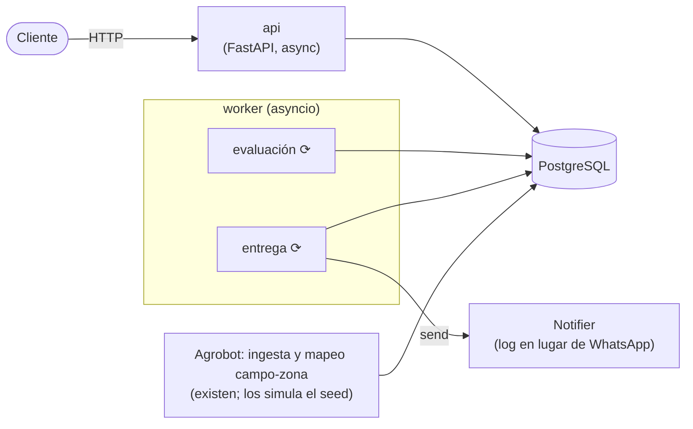
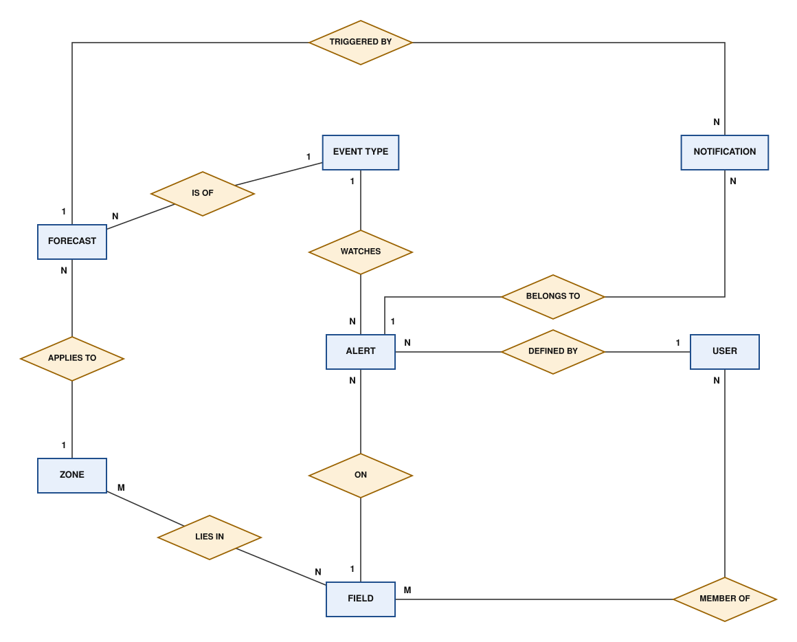

# Alertas climáticas para campos

Servicio de alertas climáticas para Agrobot (challenge técnico de FieldData). Un usuario elige uno
de sus campos, un tipo de evento y un umbral de probabilidad ("avisame cuando la helada llegue al
70%"). Un worker compara periódicamente los pronósticos guardados con cada alerta activa, registra
una notificación cuando la alerta se cumple y se la entrega al usuario. La integración real con
WhatsApp queda afuera: la entrega pasa por un *notifier* cuya única implementación escribe el
mensaje en el log.

Son dos procesos construidos con el mismo código y la misma imagen: una API HTTP (FastAPI) para
gestionar alertas y leer notificaciones, y un worker asíncrono con dos tareas periódicas.
PostgreSQL es la única infraestructura.

La especificación completa, en inglés, está en
[`docs/designs/weather-alerts.md`](docs/designs/weather-alerts.md); este README la resume.

## Contenido

- [Cómo funciona, en corto](#cómo-funciona-en-corto)
- [Cómo correrlo](#cómo-correrlo)
- [Arquitectura](#arquitectura)
- [Modelo de datos](#modelo-de-datos)
- [Semántica de las alertas](#semántica-de-las-alertas)
- [Modelo de concurrencia](#modelo-de-concurrencia)
- [Decisiones y trade-offs](#decisiones-y-trade-offs)
- [Supuestos](#supuestos)
- [Production readiness](#production-readiness)
- [Qué faltó / próximos pasos](#qué-faltó--próximos-pasos)
- [Cómo se construyó](#cómo-se-construyó)
- [Estructura del proyecto](#estructura-del-proyecto)

## Cómo funciona, en corto

**Datos que ya existen** (en Agrobot; acá los simula el seed):

- **Usuarios y campos.** Un campo puede tener varios usuarios, cada uno con un rol.
- **Zonas.** Una zona es una celda de la grilla del proveedor de pronósticos. Los datos de demo
  usan una grilla ficticia de celdas de 0,25 grados (unos 25 km).
- **Qué zonas toca cada campo y cuánto.** Por ejemplo, "Los Álamos" está 60% en una zona y 40%
  en otra. Se asume que Agrobot ya tiene este mapeo.
- **Pronósticos.** Una probabilidad por zona, tipo de evento y fecha, escrita por el job de
  ingesta que ya existe.

**Datos que crea este sistema:**

- **Alertas.** Un usuario dice "helada al 70% o más en La Esperanza" por la API.
- **Notificaciones.** Las crea el worker; cada una registra qué se detectó y si se entregó.

**Cómo corre** (dos tareas en el worker):

1. **Evaluación** (cada 5 minutos). Para cada alerta activa y cada fecha desde hoy hasta hoy + 7:
   ¿qué zonas del campo tienen un pronóstico igual o mayor al umbral, y suman al menos el 10% del
   campo? Si es así, registra una notificación para esa fecha. Hay como máximo una notificación
   por alerta y fecha.
2. **Entrega** (cada 15 segundos). Para cada alerta con notificaciones pendientes, manda **un**
   mensaje con todas sus fechas. Justo antes de mandar, vuelve a chequear cada fecha contra los
   pronósticos actuales y descarta las que ya no califican. Si el envío falla, reintenta más tarde
   con espera exponencial, hasta que la fecha pasa; una fecha que pasa sin entregarse queda como
   fallida.

El usuario lista sus notificaciones por la API para ver qué se le mandó.

## Cómo correrlo

Requisitos: Docker con Compose. Para los tests en el host, además [uv](https://docs.astral.sh/uv/)
(instala Python 3.13 solo).

### Levantar todo

```bash
docker compose up -d --build
```

Eso levanta la base, corre las migraciones (`migrate`), carga los datos de demo (`seed`) y
arranca la API y el worker. La API queda en `http://127.0.0.1:8000` (documentación interactiva en
`/docs`). En la demo el worker evalúa cada 30 segundos en vez de 5 minutos.

El seed imprime los usuarios, campos y alertas que creó:

```bash
docker compose logs seed
```

Los datos cuentan una historia por campo:

| Campo | Zonas (cobertura) | Qué muestra |
|---|---|---|
| La Esperanza | una (100%) | dos fechas frías: el walkthrough de abajo crea la alerta y llega **un** mensaje |
| Los Álamos | dos (60% / 40%) | helada solo en la zona chica: el mensaje dice "(40% del campo)" |
| El Rincón | dos (95% / 5%) | lluvia solo en la franja del 5%: **no** dispara; lluvia en las dos: dispara |
| La Compartida | una (100%) | dos usuarios con umbrales 60% y 80% sobre un 70%: solo se notifica al primero |

### Walkthrough

La identidad va en el header `X-User-Id` (un reemplazo de la autenticación real; ver
[Supuestos](#supuestos)). El usuario 1 es Ana, dueña de La Esperanza (campo 1).

Ver sus campos y los tipos de evento:

```bash
curl -s http://127.0.0.1:8000/api/v1/fields -H 'X-User-Id: 1'
```

```bash
curl -s http://127.0.0.1:8000/api/v1/event-types -H 'X-User-Id: 1'
```

Crear una alerta de helada al 70% en La Esperanza:

```bash
curl -s -i -X POST http://127.0.0.1:8000/api/v1/alerts -H 'X-User-Id: 1' -H 'Content-Type: application/json' -d '{"field_id": 1, "event_type": "frost", "threshold": 70}'
```

Dentro de unos 45 segundos (la próxima evaluación y la próxima entrega), el worker manda un solo
mensaje con las dos fechas:

```bash
docker compose logs worker | grep message_delivered
```

```text
... "message": "message_delivered", "alert_id": 5, "user_id": 1, "notification_ids": [5, 6], "text": "⚠️ Alerta de helada en \"La Esperanza\" (umbral 70%): 16/11 85%, 17/11 72%."}
```

Y las notificaciones aparecen como enviadas:

```bash
curl -s 'http://127.0.0.1:8000/api/v1/notifications?field_id=1' -H 'X-User-Id: 1'
```

Las otras tres historias ya mandaron sus mensajes en el primer ciclo (están en el mismo log). El
worker se detiene limpio, terminando el lote que esté enviando:

```bash
docker compose stop worker
```

Para borrar todo, incluida la base:

```bash
docker compose down -v
```

### Tests y chequeos

Los tests corren contra un PostgreSQL real (la base `agrobot_test` del mismo Compose), con el
esquema creado por las migraciones:

```bash
make test
```

`make check` corre todo lo que corre la CI: ruff (lint y formato), mypy estricto, migraciones
arriba, abajo y arriba otra vez, y los tests con el mínimo de 90% de cobertura:

```bash
make check
```

### API

Todas las rutas, salvo health, van bajo `/api/v1`.

| Método y ruta | Qué hace |
|---|---|
| `GET /health/live`, `GET /health/ready` | liveness; readiness con `SELECT 1` (503 si la base no responde) |
| `GET /fields` | campos de los que el usuario es miembro, con su rol |
| `GET /event-types` | los cuatro tipos (`frost`, `rain`, `strong_wind`, `heat`) con su nombre en español |
| `POST /alerts` | crea una alerta (`field_id`, `event_type`, `threshold`, `is_active`); 201 + `Location` |
| `GET /alerts`, `GET /alerts/{id}` | lista (filtros `field_id`, `event_type`, `is_active`) y detalle |
| `PATCH /alerts/{id}` | cambia `threshold` y/o `is_active` (campo y tipo son fijos) |
| `DELETE /alerts/{id}` | borra la alerta y sus notificaciones |
| `GET /notifications` | notificaciones del usuario, más nuevas primero (filtros `status`, `field_id`, `alert_id`) |

Errores con forma `{"detail": …}`: 401 sin identidad válida; 404 para recursos de otro usuario
(aunque sea miembro del mismo campo, así no se revela si existen); 409 alerta duplicada; 422
entrada inválida o tipo de evento desconocido; 503 con `Retry-After: 10` si la alerta se está
enviando en ese momento. Las listas se paginan con `limit` (1 a 100, 50 por defecto) y `offset`.

## Arquitectura



- **api**: la interfaz HTTP. Todas las rutas son `async`.
- **worker**: un proceso aparte con dos tareas periódicas independientes. Su estado vive en la
  base, así que se puede reiniciar, replicar o correr una sola vez desde un scheduler externo
  (`python -m app.worker --once`).
- **Sin broker.** La detección es idempotente por una restricción única, y la tabla de
  notificaciones funciona como *outbox*: detectar y entregar están desacoplados. Una cola (Redis,
  RabbitMQ) agregaría una pieza sin agregar una garantía.

Flujo de una alerta:

1. La API inserta la alerta (verificando que el usuario sea miembro del campo).
2. La evaluación, en **una** sentencia SQL, convierte los pares (alerta, fecha) que se cumplen en
   notificaciones pendientes; los duplicados se ignoran por la restricción única.
3. La entrega bloquea alertas con notificaciones vencidas (`FOR NO KEY UPDATE SKIP LOCKED`, así
   cada réplica toma alertas distintas), vence fechas pasadas, re-chequea las demás, manda un
   mensaje por alerta (todos en paralelo, cada uno con timeout) y registra enviado o reintento.

## Modelo de datos



El modelo conceptual completo, con atributos, está en
[`docs/designs/er-complete.svg`](docs/designs/er-complete.svg). Las tablas:

| Tabla | De quién | Qué guarda |
|---|---|---|
| `users`, `fields`, `field_members` | Agrobot (stand-in) | usuarios, campos y membresías con rol (`owner`, `agronomist`, `manager`) |
| `zones`, `field_zones` | Agrobot (stand-in) | celdas de la grilla (por su centro) y qué fracción de cada campo cae en cada una |
| `weather_forecasts` | ingesta de Agrobot (stand-in) | probabilidad por zona, tipo de evento y fecha |
| `event_types` | esta feature | los cuatro tipos con su nombre en español |
| `alerts` | esta feature | usuario, campo, tipo, umbral, activa |
| `notifications` | esta feature | fecha, valores reportados y estado de entrega (outbox) |

Lo que hace sólido al modelo:

- **Las reglas que el esquema puede expresar están en el esquema**: claves foráneas con
  `ON DELETE` explícito, `UNIQUE`, `CHECK` de rangos (umbral 1–100, probabilidad 0–100,
  cobertura y área afectada en (0, 1]), y "enviada implica `sent_at`". Todas con nombre.
- **Una alerta pertenece a una membresía**: una clave foránea compuesta `(user_id, field_id)`
  hacia `field_members` hace que la base rechace una alerta de alguien que no es miembro, y que
  quitar la membresía borre sus alertas.
- **La clave de deduplicación está en el esquema**: `UNIQUE (alert_id, forecast_date)`.
- **La notificación guarda lo que reportó** (fecha, umbral, probabilidad, área afectada); una vez
  enviada no cambia aunque cambien la alerta o el pronóstico. Su vínculo al pronóstico que la
  disparó es opcional: si la ingesta purga pronósticos viejos, el vínculo queda en `NULL`.
- **Índices para las consultas calientes**: el único de pronósticos sirve a la evaluación; un
  índice parcial sobre pendientes sirve a la entrega.
- **Dos migraciones**: `0001` crea las tablas que simulan a Agrobot (solo demo y tests) y `0002`
  las de la feature. En Agrobot, `0002` se colgaría de su última migración; revertirla borra solo
  lo que la feature agregó. La CI prueba arriba, abajo y arriba.

## Semántica de las alertas

Para una alerta y una fecha dentro de la ventana (hoy a hoy + 7):

1. Se toman las zonas del campo cuyo pronóstico para el tipo de la alerta llega al umbral
   (inclusive: `probabilidad >= umbral`).
2. El **área afectada** es la suma de sus coberturas.
3. La alerta dispara si el área afectada es al menos el mínimo configurado (10%).
4. La notificación registra el área y la probabilidad más alta entre las zonas afectadas.

Como máximo hay una notificación por alerta y fecha. Una fecha **enviada** no se vuelve a
notificar, aunque la probabilidad baje y vuelva a subir. Una pendiente que deja de calificar antes
de enviarse se borra, y si vuelve a calificar se detecta de nuevo.

**Ejemplo.** "Los Álamos" está 60% en la zona A y 40% en la zona B; alerta de helada al 70%:

| Fecha | Zona A | Zona B | Zonas ≥ 70% | Área afectada | ¿Dispara? |
|---|---|---|---|---|---|
| 15/11 | 85% | 50% | A | 60% | sí, 85% |
| 16/11 | 72% | 75% | A, B | 100% | sí, 75% |
| 17/11 | 40% | 8% | ninguna | 0% | no |
| 18/11 | 65% | 71% | B | 40% | sí, 71% |

La primera evaluación crea tres notificaciones y la siguiente entrega manda **un** mensaje:

```text
⚠️ Alerta de helada en "Los Álamos" (umbral 70%): 15/11 85% (60% del campo), 16/11 75%, 18/11 71% (40% del campo).
```

Si al día siguiente sube la helada del 19/11, el próximo ciclo manda otro mensaje solo con el
19/11. En una semana, el usuario recibe como mucho un mensaje por alerta por cada ciclo en el que
aparece una fecha nueva.

**Entrega.** Si el envío falla, se cuenta un intento para todo el grupo, se guarda el error (solo
tipo y código, nunca el texto del proveedor, que puede tener el teléfono) y se programa el
próximo intento con *backoff* exponencial y *jitter* completo, hasta 30 minutos. No hay límite de
intentos: los reintentos siguen mientras la fecha no haya pasado; una fecha que pasa sin
entregarse queda `failed` y se loguea un error. Una fecha nueva de una alerta que está esperando
un reintento hereda ese mismo horario, así no provoca un reintento antes de tiempo. La entrega es
*at least once*: tras un crash, un mensaje puede llegar dos veces (como mucho un lote).

## Modelo de concurrencia

El trabajo es casi todo espera (I/O): esperar a PostgreSQL o al proveedor de mensajería.

| Trabajo | Tipo | Dónde corre |
|---|---|---|
| Requests HTTP, queries, envíos | I/O (espera) | asyncio, un event loop por proceso |
| Cruzar alertas con pronósticos | CPU e I/O, crece con los datos | Dentro de PostgreSQL (una sentencia) |
| Agrupar un lote, armar el texto, validar input | CPU, chico y acotado | En el event loop |
| Usar más de un núcleo | Paralelismo | Más procesos: réplicas de API y worker |

**El GIL no limita este diseño.** El GIL deja ejecutar Python a un solo hilo por vez, así que los
hilos no sirven para trabajo CPU-bound; pero acá no hay trabajo CPU-bound en Python: el cruce
pesado lo hace la base, y Python solo coordina esperas. Un event loop sostiene muchas esperas a la
vez sin un hilo por request. El paralelismo viene de procesos, que el diseño ya tolera.

Las reglas:

1. Toda ruta, dependencia y tarea es `async` y solo espera I/O asíncrona (asyncpg, `AsyncSession`).
2. Nada bloquea el event loop: ni `sleep`, ni HTTP o base sincrónicos, ni archivos. Las reglas
   `ASYNC` de ruff lo vigilan en la CI. Única excepción aceptada: los logs se escriben a stdout
   de forma sincrónica (una escritura local corta).
3. Ningún loop de Python sobre alertas o pronósticos; Python maneja como mucho un lote.
4. Si hiciera falta una librería bloqueante (un SDK de WhatsApp sin cliente async), va detrás del
   notifier en `asyncio.to_thread`: los hilos sirven para I/O bloqueante porque el GIL se libera
   mientras esperan. Así se escribe el archivo de heartbeat del worker.
5. Si hiciera falta Python CPU-bound, va a otro proceso, nunca a hilos.
6. Una sesión de base por request o tarea, nunca compartida entre tareas concurrentes.
7. Cada proceso tiene su intérprete, su GIL, su loop y su pool. Conexiones totales = procesos ×
   (pool + overflow), por debajo del límite de PostgreSQL.

**Réplicas.** Se coordinan solo por la base: un *advisory lock* hace que evalúe una réplica por
vez (las otras saltean el turno; la restricción única evita duplicados igual), y cada
despachador bloquea alertas distintas con `SKIP LOCKED`. El lote de entrega mantiene su
transacción abierta mientras envía (acotado al timeout de envío): si el worker muere, PostgreSQL
libera sus locks solo; las conexiones del worker tienen timeout de transacción inactiva y TCP
keepalives para eso.

**Apagado.** El primer SIGTERM termina y guarda el lote que se está enviando, no toma otro, y
cancela una evaluación en curso (repetirla es seguro). Un segundo SIGTERM cancela todo: el lote se
revierte y sus notificaciones quedan pendientes.

## Decisiones y trade-offs

Cada una con su alternativa. El razonamiento completo está en la sección *Alternatives
Considered* del [design doc](docs/designs/weather-alerts.md#alternatives-considered).

| Decisión | Elegido | Alternativa | Por qué |
|---|---|---|---|
| Tareas en segundo plano | Worker propio con asyncio, solo PostgreSQL | Celery / arq / Taskiq (Redis), APScheduler | El estado ya vive en la base; un broker es una pieza más sin garantía extra |
| Cuándo notificar | Una notificación por alerta y fecha, idempotente por `UNIQUE` | Máquina de estados por alerta | Una regla simple, segura con reintentos y réplicas |
| Agrupar | Un mensaje por alerta con todas sus fechas | Un mensaje por fecha | En WhatsApp cada mensaje cuesta atención (hasta 8 por semana lluviosa) |
| Detección y entrega | Outbox (tabla de notificaciones) | Enviar dentro de la evaluación | Una caída de WhatsApp no frena ni pierde detecciones |
| Evaluación | Una sentencia `INSERT … SELECT … ON CONFLICT DO NOTHING` | Cargar alertas y loopear en Python | Un viaje a la base, atómico, sin N+1 ni CPU en el loop |
| Lock de entrega | Transacción abierta durante el envío | Lease (`locked_until`) | Un crash libera los locks sin código de limpieza; costo acotado a un lote por 10 s |
| Identidad | Header `X-User-Id` con chequeos de pertenencia reales | Usuario en la URL sin identidad | La pertenencia se aplica y se testea; la auth real reemplaza una dependencia |
| Tipos de evento | Tabla con FK | Lista fija en el código | Un tipo nuevo es una fila, no un deploy |
| Probabilidad | Entero 0–100 (`SMALLINT`) | Fracción o float | Comparación exacta; así lo dice un productor ("70%") |
| Historial | La notificación se borra con su alerta | Conservarla con `alert_id` nulo | Toda notificación tiene alerta, sin camino redundante al usuario |
| IDs | `BIGINT` identity | UUID | Índices más chicos; la API responde 404 a recursos ajenos |
| Usuarios y campos | Muchos a muchos con rol | Un dueño por campo | Un campo tiene dueño, agrónomo, encargado |
| Ubicación | Zonas de la grilla con cobertura | Una coordenada por campo; pronóstico por campo | Un campo grande cruza varias celdas; campos vecinos comparten pronóstico |
| Área mínima | 10% global, sumando coberturas | Disparar si cualquier zona llega | Una franja chica en otra celda no debe disparar |
| Proveedor del clima | Ninguno; datos simulados | Integrar una API real | El brief pide datos simulados y dice que la ingesta ya existe |
| Tests | PostgreSQL real, esquema por migración | SQLite o rollback por test | `ON CONFLICT`, `SKIP LOCKED` y los `CHECK` son comportamiento de PostgreSQL |
| Concurrencia | asyncio, procesos para paralelismo | Hilos con código sincrónico; build free-threaded | El trabajo es I/O; el GIL no lo limita |

## Supuestos

1. No se elige proveedor de clima. El diseño se modela sobre cómo responden APIs como Open-Meteo,
   OpenWeather y el US National Weather Service: se manda un punto y se obtiene el pronóstico de
   la zona que lo contiene. Una zona se guarda por su centro.
2. El job de ingesta existente trae pronósticos para cada zona y hace *upsert* de una fila por
   zona, tipo y fecha, cambiando solo la probabilidad y su timestamp, en transacciones cortas;
   purga solo fechas pasadas.
3. Agrobot ya sabe qué zonas toca cada campo y qué fracción cae en cada una (las coberturas de un
   campo suman 100%). Acá lo escribe el seed. Si no existiera, el design doc describe cómo
   calcularlo.
4. Todo evento se expresa como probabilidad, así que el umbral es un porcentaje de 1 a 100.
5. El umbral es inclusivo ("a partir del cual"): cuenta `probabilidad >= umbral`.
6. Un campo puede tener varios usuarios; una alerta es del usuario que la creó y solo se le
   notifica a él.
7. Usuarios y campos ya existen en Agrobot; acá hay tablas mínimas que los simulan.
8. Las fechas de pronóstico son locales: "hoy" se calcula en una zona horaria configurada
   (`America/Argentina/Buenos_Aires`), no en UTC, y con el reloj de la base para que las
   réplicas coincidan.

**Atajo documentado:** el header `X-User-Id` permite actuar como cualquier usuario. Por eso
Compose publica la API solo en `127.0.0.1`. **Nunca debe quedar expuesto a una red.**

## Production readiness

Lo que está construido:

- **Configuración** por variables de entorno con defaults, validada al arrancar (ver
  [`.env.example`](.env.example)).
- **Logs JSON** con mensajes estáticos e identificadores como campos (`evaluation_completed`,
  `notification_send_failed`, `notification_expired`, `job_failed`…); nunca teléfonos.
- **Health checks**: liveness y readiness en la API; el worker escribe un heartbeat por tarea y
  su contenedor se marca *unhealthy* si el de la entrega queda viejo.
- **Idempotencia** por restricción única; **reintentos** con backoff exponencial y jitter;
  **timeouts** por envío, por lock (5 s) y por sentencia (30 s; 240 s para la evaluación).
- **Apagado limpio** con drenado en SIGTERM; modo `--once` para schedulers externos.
- **Validación de entrada** estricta y errores de dominio mapeados a HTTP; un catch-all que
  loguea una vez y responde 500 sin detalles internos.
- **Chequeos de datos** en cada evaluación: alertas sobre campos sin zonas o con coberturas que
  no suman 100% (`alerts_without_zones`), y zonas sin pronósticos recientes o completos
  (`forecasts_stale`).
- **Calidad**: mypy estricto, ruff (incluidas las reglas `ASYNC` y de zonas horarias), tests
  contra PostgreSQL real (unitarios, de integración, de API, de concurrencia y uno de punta a
  punta) con cobertura mínima de 90%, CI en GitHub Actions.
- **Imagen Docker** multi-stage, sin dependencias de desarrollo, usuario no root.

## Qué faltó / próximos pasos

La lista completa está en *Future improvements* del design doc. Lo principal, en orden:

1. **Cliente real de WhatsApp**: errores permanentes vs transitorios, clave de idempotencia del
   proveedor, plantilla aprobada y límites de envío.
2. **Métricas y trazas**: notificaciones fallidas, atraso de las tareas; escribir logs fuera del
   event loop (`QueueHandler`).
3. **Reglas de re-notificación**: re-armar cuando la probabilidad baja y sube, escalamiento,
   aviso de "ya pasó".
4. **Autenticación real** (reemplaza una dependencia) y *row-level security* como segunda capa.
5. **Historial** de notificaciones al borrar una alerta; texto del mensaje guardado para auditoría.
6. **Escala**: evaluar solo alertas cuyos pronósticos cambiaron; *lease* en vez de transacción
   abierta para proveedores lentos; *circuit breaker* ante caídas del canal; PgBouncer.
7. **Configuración por alerta** (área mínima, horizonte), zona horaria por campo, granizo,
   avisar a otros miembros del campo, re-encolar notificaciones fallidas, paginación por cursor.
8. **Calcular el mapeo campo-zona** acá si Agrobot no lo tuviera (método descrito en el design
   doc), y un adaptador real de proveedor de clima.

Consecuencia aceptada: borrar y recrear una alerta vuelve a notificar las fechas de la ventana,
porque las notificaciones se borran con su alerta.

## Cómo se construyó

Con un agente de IA (Claude Code), de forma *spec-driven*:

1. **Plan y diseño primero.** Antes de escribir código se escribió un plan con cada decisión y su
   alternativa, y un design doc (`docs/designs/weather-alerts.md`) en el formato del
   [Elephant-Goldfish Model](https://github.com/google/elephant-goldfish-model). El modelo de
   datos partió de un diagrama entidad-relación dibujado a mano por mí.
2. **Revisión con contexto fresco.** El design doc pasó por las etapas de revisión de EGM:
   agentes revisores que solo veían el documento, en varias rondas. Cada hallazgo lo decidí yo;
   entre otras cosas, encontraron una carrera que podía mandar dos veces el mismo mensaje y un
   lock que un worker muerto podía retener por horas.
3. **Implementación por pasos.** El agente implementó el plan paso a paso, un commit por paso,
   corriendo tests, lint y tipos en cada uno. Los commits hechos con el agente llevan la línea
   `Co-Authored-By: Claude`.
4. **Chequeo de drift.** Antes de entregar, un reporte de drift compara el design doc con el
   código y cada diferencia se resuelve de un lado o del otro.

Todas las decisiones, lo que se discutió y lo que se descartó están en
[`docs/build-log.md`](docs/build-log.md).

## Estructura del proyecto

```text
app/
  main.py               fábrica de la app FastAPI (uvicorn --factory app.main:create_app)
  config.py             settings desde variables de entorno, validados
  logging.py            logs JSON o de consola
  db.py                 engine, sesiones, timeouts por conexión, reloj de la base
  enums.py              estado de notificación y rol de miembro
  models.py             las nueve tablas (SQLAlchemy 2)
  schemas.py            modelos de request y response
  errors.py             errores de dominio y su mapeo a HTTP
  api/deps.py           sesión, usuario actual, paginación
  api/routes/           health, fields, event_types, alerts, notifications
  services/alerts.py    CRUD de alertas con pertenencia
  services/evaluation.py  la regla de disparo y la sentencia de evaluación
  services/dispatch.py  un lote de entrega, backoff y texto del mensaje
  notifiers.py          el puerto del notifier y su implementación que loguea
  worker.py             runner periódico, tareas, señales, --once, --healthcheck
  seed.py               datos de demo
alembic/versions/       0001 (stand-ins de Agrobot) y 0002 (la feature)
tests/                  tests contra PostgreSQL real
docs/designs/           design doc y diagramas
docs/build-log.md       cómo se llegó al diseño
Dockerfile, docker-compose.yml, Makefile, .github/workflows/ci.yml
```
